# How it works inside

[`use-cases.md`](use-cases.md) says *what* the household can do. This page says *how*:
which classes a request passes through, in what order, what each one reads and
writes, and where the rules and the transactions sit. Each section is one part of the
system, in the order the data flows: the runtime, the tables, the settings, the vault,
the planner, the grocery list, and then where the parts that aren't built yet plug in.

Read the diagrams with this key:

- **Solid** boxes and arrows are code that exists and runs today.
- **Dashed grey** boxes are parts that are not built yet, drawn where they will plug
  in, with the ticket that builds them.
- File references are relative to the repository root. `MealPlanner.php:135` means
  `app/Planning/MealPlanner.php`, line 135, as of the commit that added this page.

Two facts shape everything below:

1. **There are exactly two front doors to the planning logic today:** `milly:plan` and
   `milly:groceries`, run in a terminal. The pages edit the data the planner reads;
   no page calls the planner yet (MM-8).
2. **`MealPlanner` and `GroceryListBuilder` are the only classes that touch the
   database for planning.** Everything they call (`NightPicker`, `GroceryMerge`, …)
   is plain PHP with no database, which is why it is unit-tested in `tests/Unit`.

---

## 1. The runtime

Three containers on one machine at home. Nothing is reachable from outside the home
network, and nothing goes out to the internet yet.

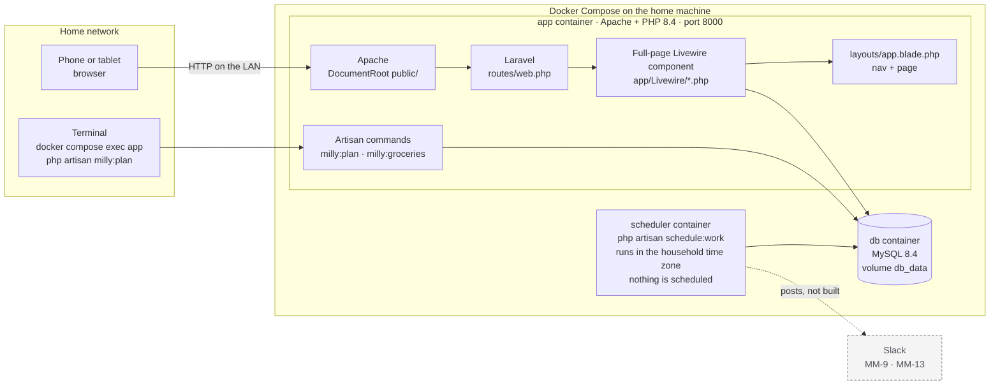

**On boot, the `app` container** (`docker/entrypoint.sh`) does this, in order: copy
`.env.example` to `.env` if missing → `composer install` → generate `APP_KEY` →
`npm ci` and `npm run build` if the assets are missing → wait for MySQL → `migrate` →
seed `HouseholdDefaultsSeeder` (it only *adds* settings, so edits survive a restart) →
start Apache. The **scheduler** waits for the app to be healthy, then runs
`schedule:work`. `routes/console.php` declares no jobs, so it logs "No scheduled
commands are ready to run" every minute.

**A page request**: Apache → `public/index.php` → `routes/web.php`, which maps each
URL straight to a Livewire class (`/recipes` → `App\Livewire\Recipes`) → the
component renders inside `resources/views/layouts/app.blade.php`. There is no login
and no middleware of the app's own. A click on the page posts back to Livewire's
update endpoint, which calls a public method on the same component.

**Clocks**: everything is stored in UTC (`config/app.php`). The household's time zone
is the `time_zone` setting. `AppServiceProvider::scheduleInTheHouseholdTimeZone()`
copies it into `app.schedule_timezone` when a console command boots, so a future
`dailyAt('15:00')` fires at 3 pm in the kitchen.

**Sessions, cache and queue** all use the database driver. There is no queue worker,
and nothing dispatches a job or reads the cache.

---

## 2. The tables

Every household table, and what happens to the rows that point at a row you delete.
The arrow labels say what a delete does: `cascade` deletes the children,
`null on delete` empties the pointer.

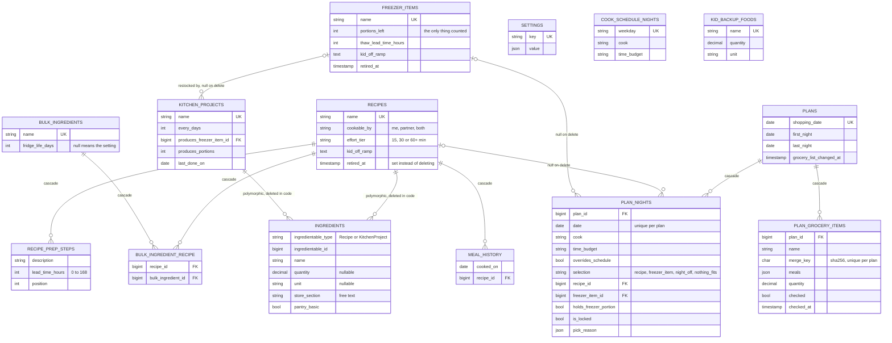

What the shape of these tables decides:

- **A plan night copies its cook and time** from `cook_schedule_nights` rather than
  pointing at it, so editing the normal week never rewrites a plan already made.
- **`ingredients` is one table for two owners.** It has no database foreign key, so
  `Recipe` and `KitchenProject` delete their ingredients in a `deleting` model event.
  It exists so that a kitchen project's needs can join the same grocery merge (MM-12).
- **The deletes are why recipes are retired, not deleted.** Deleting a recipe would
  cascade away its `meal_history` (the variety rule's only input) and null out
  `plan_nights.recipe_id` (a planned night with no dinner). So "remove" sets
  `retired_at`, and a real delete is only allowed when nothing points at the row.
- **The grocery list is stored**, one row per line, so two phones see the same ticks.
  `unique (plan_id, merge_key)` makes the database refuse a second row for one line.
- `settings`, `cook_schedule_nights` and `kid_backup_foods` stand alone. Nothing
  points at them.

---

## 3. Settings

One row per setting in `settings`, the value stored as JSON. Every read goes through
`App\Settings\HouseholdSettings`, which holds every default in one place
(`defaults()`). There is **no cache**: each getter is one `SELECT`, so a change on the
Settings page is seen by the very next command.

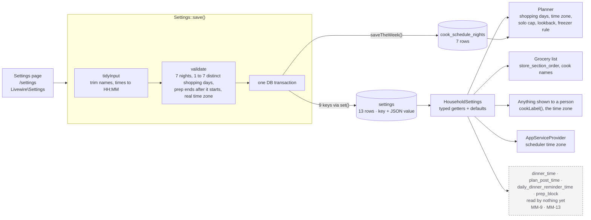

- **The page edits 9 of the 13 settings.** `variety_lookback_days`,
  `partner_solo_effort_cap`, `freezer_meals_on_chaos_nights_only` and
  `store_section_order` are seeded and read by the engine, and nothing writes them
  (MM-22 puts them on the page).
- **Four settings are written and never read**: the dinner time, the plan-post time,
  the daily reminder time and the prep block. They are waiting for the scheduled jobs
  (MM-9, MM-13).
- **`cookLabel()`** is how a cook becomes a name on screen: the household's name for
  `me` and `partner`, the enum's own label for `together` and `nobody`. Names are
  applied when something is shown, never stored in a plan, so renaming a cook renames
  them everywhere.
- **`shoppingTimes()` sorts Monday-first when read**, not when saved.
- **`at('18:00', $date)`** turns a stored time plus a calendar date into a real moment
  in the household's zone. It is how "after the shop" is worked out.

---

## 4. The vault

The vault pages are forms over the tables in section 2. Two of their flows are worth
drawing: saving a recipe, and taking one out of the vault.

### Saving a recipe

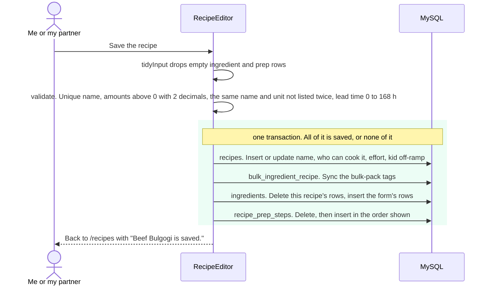

The ingredients and prep steps are **rewritten wholesale** rather than matched row
by row. That is safe because nothing points at an ingredient row by id: the grocery
list copies amounts out of them when it is built.

**The editor never touches the stored grocery list.** An edited recipe makes the
list stale, and the list catches up the next time it is read through the builder
(section 6).

### Taking a recipe or a freezer meal out of the vault

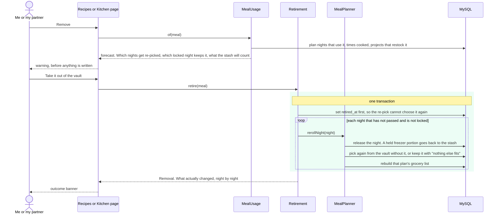

- **Forecast and outcome are separate objects on purpose.** `MealUsage` predicts;
  `Removal` reports what really happened by comparing each night before and after.
  They differ when nothing else fits a night and the planner keeps the meal.
- **Locked nights and nights that have passed are never re-picked.** A lock is the
  household's answer for that date, and a past night is history.
- **"Delete for good"** goes through `Retirement::deleteForGood()`, which locks the
  row (`SELECT … FOR UPDATE`), checks again inside the transaction that nothing
  points at it, and only then deletes. A page left open while a plan was made cannot
  destroy anything.
- **`MealUsage`, `Removal` and `UsedNight` are pure values** apart from
  `MealUsage::of()`, so the wording of every warning is unit-tested without a
  database.

---

## 5. Planning a window

`MealPlanner` is the one class the rest of the app is meant to call. It reads
settings and the vault, turns them into plain values, hands them to the picking
classes, and writes the result. The picking classes never see the database.

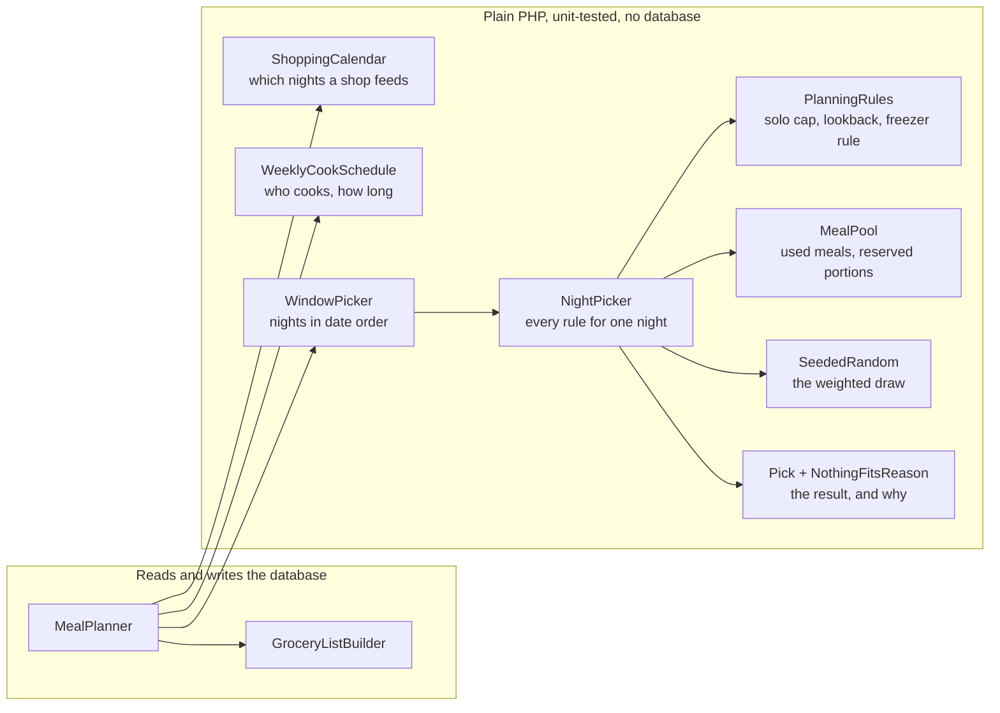

### `milly:plan`, step by step

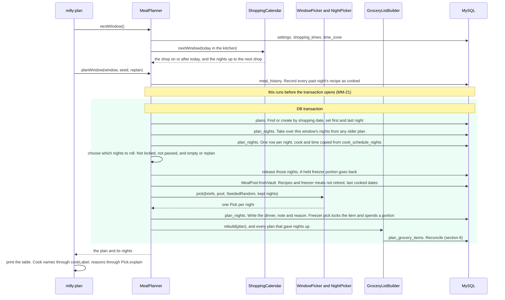

- **Everything except the history catch-up is one transaction.** If a freezer
  portion runs out halfway (`PlanningException::noPortionsLeft`), the whole plan
  rolls back. The catch-up is outside it, which is one of MM-21's two complaints.
- **`--dry-run` runs exactly the same code** inside a transaction it always rolls
  back (`previewWindow()`), so the preview can never disagree with the real thing.
- **The seed is not stored.** `--seed=42` makes a roll repeatable for tests and demos;
  a normal roll is fresh every time.
- **Nights that have passed are history**: never invented, never re-rolled, never
  moved to another plan, never given new cooks, and their freezer portion is never
  handed back.

### How one night is picked

`NightPicker::pick()`. Everything it needs is passed in, so every branch here has a
unit test.

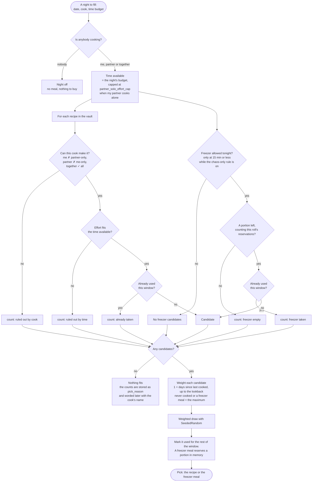

- **"No repeat in a window" is the only hard rule about variety.** Having been
  cooked recently only means fewer tickets in the draw (21 days by default), so a
  small vault still produces a dinner.
- **Freezer meals skip the cook and effort checks.** They are 80% prepped, so they
  only need the night to be short enough.
- **Retired recipes never reach the picker.** `MealPool::fromVault()` only loads
  rows with no `retired_at`.
- **The reason is stored as counts, not as a sentence** (`NothingFitsReason`),
  because the sentence names the cook and the cook's name is a setting that can
  change.

### The freezer portion lifecycle

`freezer_items.portions_left` is the only thing in the app that is counted. Exactly
one method takes a portion out (`MealPlanner::reservePortionFor`) and exactly one
puts one back (`PlanNight::releaseFreezerPortion`). The night records that it is
holding one (`holds_freezer_portion`), so releasing twice cannot add a portion that
was never taken.

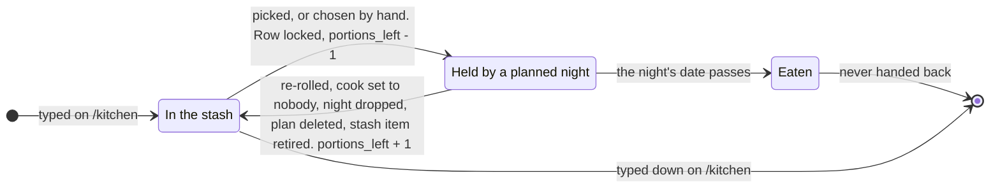

- **A plan's `deleting` event releases its nights' portions.** It has to be the plan:
  `plan_nights` rows go by MySQL cascade, so no event on a night would ever fire.
- **The `/kitchen` form only writes counts the household typed.** The planner spends
  and returns portions while the page is open, and posting every row back would undo
  that.
- **Nothing adds portions when a project is done** (MM-12), and nothing warns when the
  stash runs low (MM-12).

---

## 6. The grocery list

`GroceryListBuilder` is the only grocery class that touches the database. It turns a
plan into needs, hands them to the pure merge classes, and reconciles the result with
the stored rows.

### From a plan to a list

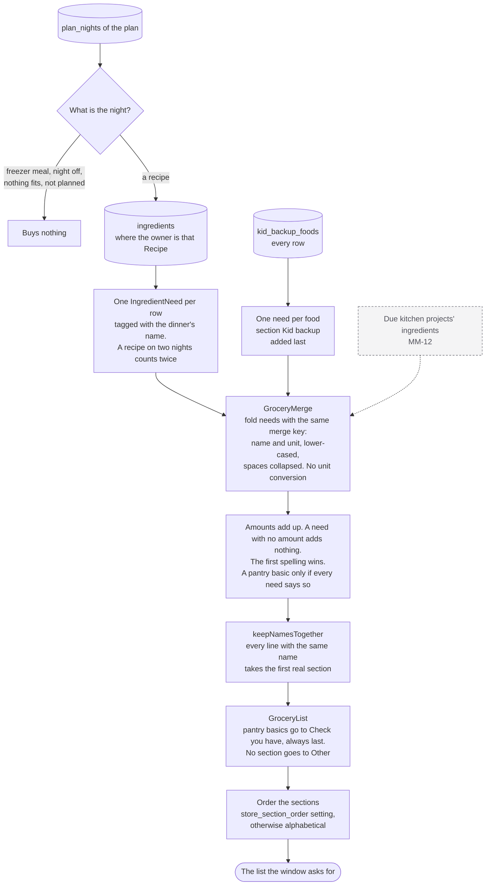

Why `1 lb` and `500 g` of beef stay two lines: they have different merge keys, and
converting between them would be the app inventing household data. Both lines share
a section, so they sit next to each other.

### Rebuilding without losing a tick

The list is **stored**, because both phones must see the same ticks. When the plan
changes, `rebuild()` reconciles line by line instead of replacing the list.

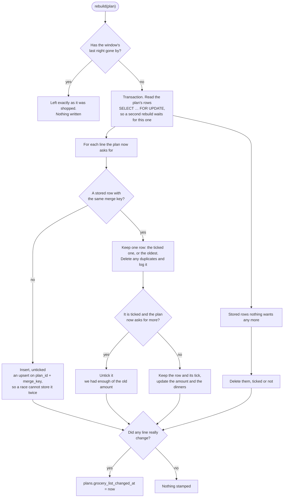

- **"Asks for more"** means the amount went up, or an amount appeared at the same
  time as a second dinner started wanting the line. The same single dinner gaining an
  amount is a recipe getting more precise, and keeps its tick.
- **The rebuild runs inside the planner's transaction** when the planner calls it.
  That keeps the dinner and the list in step, and it is also MM-24's bug: a failure
  while building the list rolls back the dinner change that caused it.
- **`grocery_list_changed_at` after the shopping time** is the "the plan changed after
  the shop" warning (`Plan::groceryListChangedAfterShopping()`). It compares against
  `HouseholdSettings::at(shop time, shopping date)`.

### Reading the list

| Method | What it does | Writes? |
| --- | --- | --- |
| `listFor()` | The list exactly as stored, with its ticks | No |
| `previewFor()` | What the plan asks for right now, without ticks | No |
| `isStale()` | Compares those two, ignoring ticks | No |
| `currentFor()` | `listFor()`, but rebuilds first if stale. **What a page should call** | If stale |
| `textFor()` | `currentFor()` as plain text, the body of the MM-9 post | If stale |

A list goes stale without the plan changing whenever somebody edits a recipe's
ingredients or the kid backup foods, which is why readers use `currentFor()`.
`milly:groceries` rebuilds on the first run, on `--rebuild`, or when `isStale()`
says so.

**Ticking exists and nothing calls it.** `PlanGroceryItem::check()` is a conditional
`UPDATE … WHERE checked = false`, so when two phones tick one line, exactly one wins.
Only tests call it until the plan page lands (MM-8).

---

## 7. Where the parts that aren't built plug in

Everything in this diagram's dashed boxes is missing. Everything solid already
exists and is waiting for it, so each future ticket is mostly wiring.

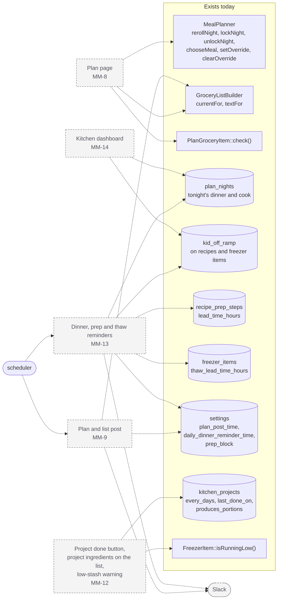

| Ticket | What it calls or reads that already exists |
| --- | --- |
| **MM-8** plan page | All six `MealPlanner` night methods (they have no caller today), `GroceryListBuilder::currentFor()`, `PlanGroceryItem::check()`, `Plan::groceryListChangedAfterShopping()` |
| **MM-9** shopping-day post | `GroceryListBuilder::textFor()` (what `milly:groceries --text` prints), the `plan_post_time` setting, `config/services.php`'s Slack token. The first job in `routes/console.php` |
| **MM-13** reminders | `plan_nights` for tonight, the kid off-ramp columns, `recipe_prep_steps.lead_time_hours` (`RecipePrepStep::isAheadOfTheDay()` has no caller), `freezer_items.thaw_lead_time_hours`, the reminder-time settings |
| **MM-14** dashboard | The same night data as MM-13, rendered as a page with `wire:poll` |
| **MM-12** projects | `KitchenProject::dueOn()` (only the Kitchen page's label reads it), `produces_portions`, `FreezerItem::isRunningLow()`, and the recipe-only filter in `GroceryListBuilder::needsByRecipe()` to widen to projects |
| **MM-11** bulk pairing | `bulk_ingredients`, its fridge life (`BulkIngredient::fridgeLifeDays()`), and the recipes' tags. It has to bend `NightPicker`'s weighted draw rather than replace it |
