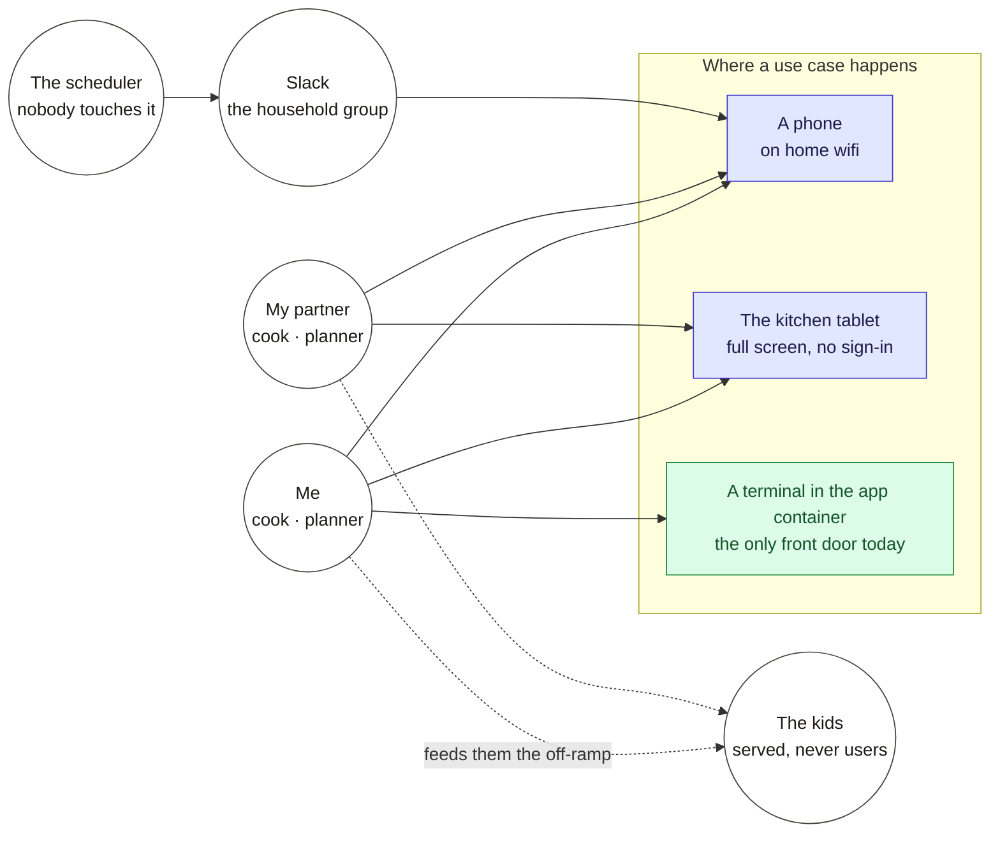
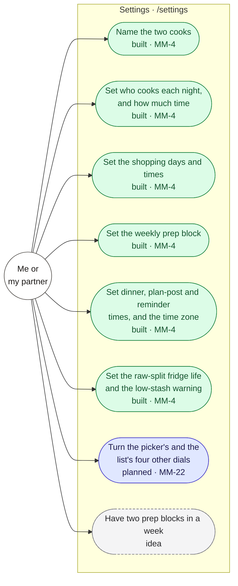
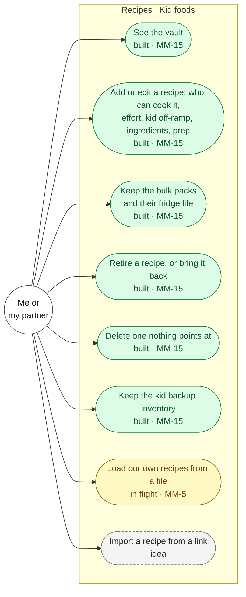
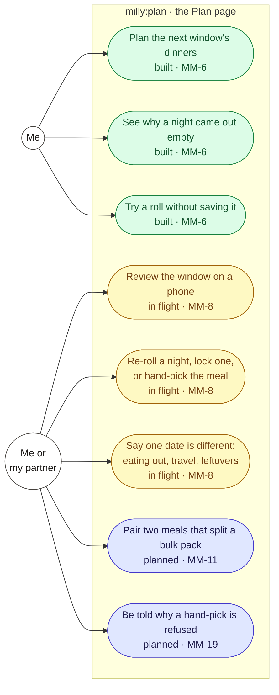
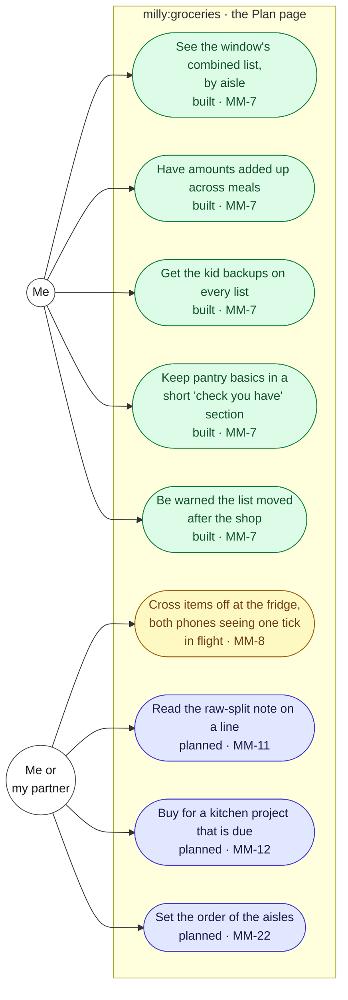
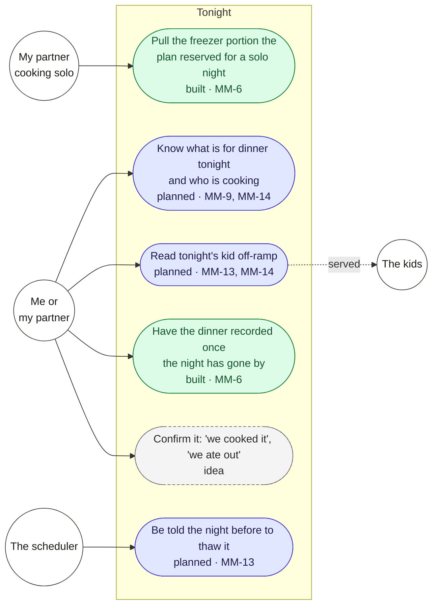
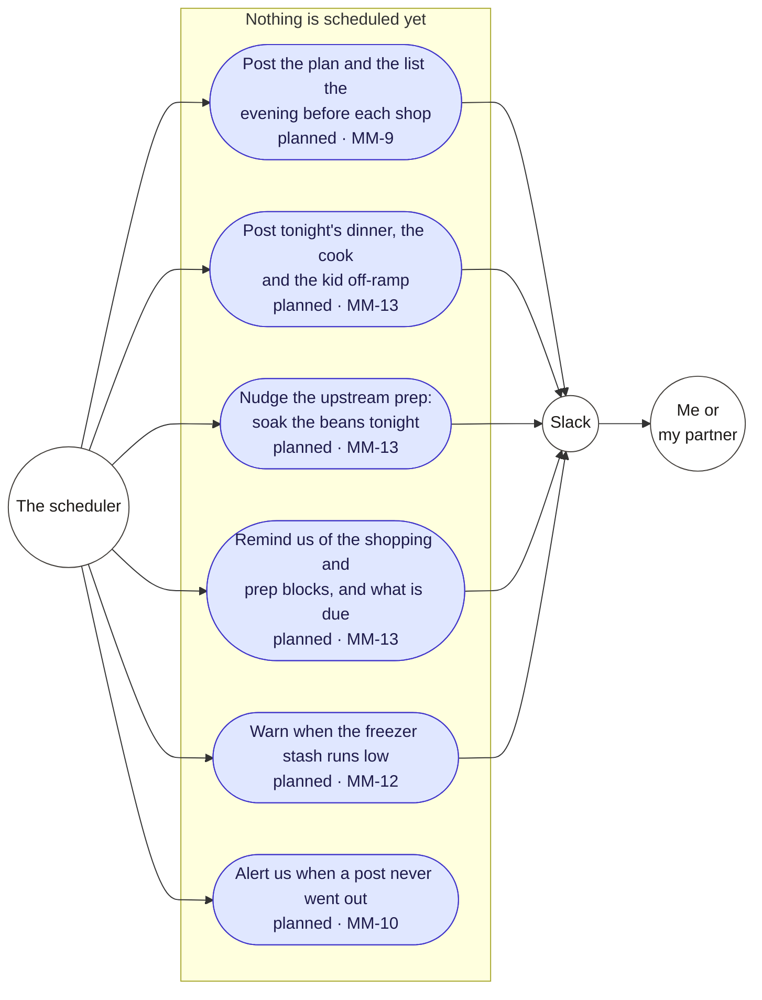
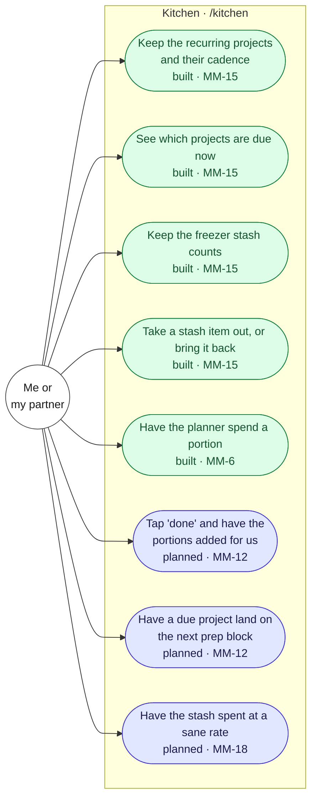

# Use cases: what's built, what's planned

What the household can already do with this app, and what is still ahead — as
diagrams, grouped by what they are trying to get done rather than by ticket. Read it
with [`AppPlan.md`](../AppPlan.md), which is where the actors and the needs come
from, and [`docs/decisions.md`](decisions.md), which is what each merged ticket
decided.

The useful part is at the bottom: [**the gaps**](#the-gaps) — what `AppPlan.md` asks
for that no ticket covers.

This page is the outside view. For the inside — which classes a request passes
through, what they read and write, and where the rules and transactions sit — see
[`how-it-works.md`](how-it-works.md).

## How to read this

Every use case carries a ticket and a state.

| Tag | What it means |
| --- | --- |
| **built** | The code does it today, from the route or the command named beside it. |
| **in flight** | A ticket is being worked now — in Doing or Needs Review — and its code is not on `main`. That covers both MM-8, whose branch is written and under review, and MM-5, which is open and waiting on the household. |
| **planned** | A ticket exists, in the backlog. Nothing is written. |
| **idea** | `AppPlan.md` or the parking lot in `docs/decisions.md` asks for it. No ticket. |

**Built means a person can reach it.** Several rules the picker and the grocery list
already enforce have no surface anybody can touch — the planner can lock a night and
tick an item off, but nothing a person can press calls either. Those are tagged with
the ticket that gives them a surface, and the table says where the logic already
lives, so nobody rebuilds it. Keeping that distinction is the reason this page was
checked against the code instead of against the board.

**Built does not mean right.** Four merged paths have open fix tickets against them —
MM-18, MM-20, MM-21 and MM-24 — and a row that sits on one says so, as
**fix open: MM-nn**. Don't plan a ticket off a `built` tag without reading the fix
beside it.

Where a built use case has a demo note in [`docs/demos/`](demos/), it is linked.
**Nothing here links to one yet:** every ticket in the "built" column merged before
that convention existed, and back-filling a note from memory is worse than no note.
This ticket's own note is [`docs/demos/MM-26.md`](demos/MM-26.md).

### How this was checked

Against the working tree of this branch, not the board. The stack was booted
(`docker compose up`), migrated and seeded with `ExampleDataSeeder` — the five
sample recipes from `AppPlan.md` — and then:

- `php artisan route:list` — the 10 routes in `routes/web.php`, plus `/`, `/up` and
  the framework's own (`storage/{path}`, Livewire's endpoints): 23 in total.
- `php artisan list milly` — exactly two commands: `milly:plan` and `milly:groceries`.
- `php artisan schedule:list` — *"No scheduled tasks have been defined."*
- Both commands run, with `--seed`, `--dry-run`, `--replan`, `--rebuild` and `--text`.
- All 10 of the app's own routes opened in a browser and read — the five in the
  navigation and the five editor routes behind them.
- `php artisan test` — 783 passed.

Where a claim below rests on something being *absent*, the absence was grepped for
and is named.

## The actors and the two surfaces

`AppPlan.md` has five actors. Two cooks who are also the two planners; two kids who
are served and never touch the app; and two things that act with nobody in the room —
the scheduler and Slack. The use cases are meant to happen on a phone and on the
kitchen tablet. Today they happen in a terminal.

| Actor | What they do | Where they are today |
| --- | --- | --- |
| **Me** | Cook, and the one who runs the planner | The terminal; the vault pages on a phone |
| **My partner** | Cook, equally a planner. Solo nights are the constraint the picker bends for | The vault and Settings pages on a phone |
| **The kids** | Never users. They are *served*: every recipe carries a kid off-ramp note and the backup inventory goes on every list | — |
| **The scheduler** | Runs `schedule:work` in its own container, on the household's clock | Running, with **nothing scheduled** (MM-9, MM-13, MM-10) |
| **Slack** | The shared household group both cooks read | **Nothing posts to it.** No Slack class, job or call exists in `app/` — only the config placeholders in `config/services.php` (MM-9, MM-13) |

The phone layout is real for the pages that exist — `tests/Feature/PhoneLayoutTest.php`
pins it — and the kitchen tablet has no page of its own yet (MM-14).

---

## 1. The household's own rules

Everything the household might want to change is a setting, not a constant. This is
the group that makes all the others work without touching code.

| Use case | State | Where it lives |
| --- | --- | --- |
| Name the two cooks | built · MM-4 | `/settings` → "The cooks". Renaming reaches the plan, the posts and the dashboard through `HouseholdSettings::cookLabel()` |
| Who cooks each night, and how long | built · MM-4 | `/settings` → "The week", seven rows in `cook_schedule_nights` |
| The shopping days and times | built · MM-4 | `/settings` → "Shopping days". 1–7 trips; comes back in weekday order (MM-16) — the page showed `Wednesday 5:30 pm · Sunday 10:00 am` |
| The weekly prep block | built · MM-4 | `/settings` → "The prep block", a weekday and a start/end |
| Dinner time, plan-post time, daily reminder time, time zone | built · MM-4 | `/settings` → "When things happen". **Stored and read; nothing fires on them yet** (MM-9, MM-13) |
| Raw-split fridge life, low freezer stash warning | built · MM-4 | `/settings` → "Planning rules" |
| Variety lookback, partner's solo cap, freezer-on-chaos-nights, store aisle order | planned · MM-22 | The settings exist and the engine reads them (`PlanningRules::fromSettings()`, `GrocerySectionOrder`); the page has no control for them — only the two above appear under "Planning rules" |
| Two prep blocks in one week | idea | `docs/decisions.md` (MM-4) says the setting has to become a list "in its own ticket". No ticket exists |

---

## 2. Keeping the vault and the inventories

Everything `AppPlan.md`'s "What information does the system need to track?" lists can
be added, changed and removed in the app. This is the most finished group.

| Use case | State | Where it lives |
| --- | --- | --- |
| See every recipe, and what each one is missing | built · MM-15 | `/recipes`. Opened: the five seeded recipes, each with who may cook it, its effort tier, its counts and its bulk packs |
| Add or edit a recipe | built · MM-15 | `/recipes/new`, `/recipes/{recipe}/edit`. Opened: name, who can cook it, effort tier, kid off-ramp, the bulk-pack checkboxes, the ingredient rows (amount, unit, store section, pantry basic) and the prep steps with hours ahead. One transaction per save |
| Keep the bulk packs | built · MM-15 | `/recipes/bulk-ingredients`. Opened: `Ground beef` at 2 days, `Tortillas` blank — blank means the Settings default |
| Retire a recipe so the picker stops drawing it, or bring it back | built · MM-15 | `/recipes`. `recipes.retired_at`, not a delete: `meal_history` and any plan night pointing at it stay true |
| Delete a recipe for good | built · MM-15 | `/recipes`, offered only when no history and no plan night point at it, re-checked inside the transaction |
| Keep the kid off-ramp inventory | built · MM-15 | `/kid-foods`. Opened: the five seeded backups, each with the amount and the unit it is bought in |
| Load the household's own recipes, kid foods, projects and stash from a file | in flight · MM-5 | **Nothing exists yet.** `app/Console/Commands/` holds only the two `milly:*` commands; `artisan list milly` confirms. The ticket is in Doing, waiting on the household's own recipes |
| Import a recipe from a link | idea | Parking lot in `docs/decisions.md` |

---

## 3. Planning a shopping window

The picker works, and every rule in it is unit-tested. What it has no surface for is
the household *changing its mind* — the whole "until you shop, you can re-roll, lock
or swap any night" promise is engine-only today.

| Use case | State | Where it lives |
| --- | --- | --- |
| Plan the next window's dinners | built · MM-6 | `php artisan milly:plan`. Ran it: *"Shopping Sun 29 Nov — 3 nights: Mon 30 Nov to Wed 2 Dec"*, a cook, a time budget and a dinner on each night. The time column has a known defect — see the solo-night row |
| Match the night's cook and time, and favour what hasn't been cooked lately | built · MM-6 | `app/Planning/` — `NightPicker`, `WindowPicker`, `MealPool`. The variety half weights by days since last cooked, read from `meal_history`, which `planWindow()` fills in as nights pass (group 5) |
| Narrow a solo night to her quick meals or the freezer | built · MM-6, **fix open: MM-20** | The cap is `PlanningRules::timeAvailableOn()`, called from `NightPicker`. The narrowing is real; `milly:plan` then **prints the night's scheduled time, not the capped one** — a 60-minute Saturday she is on her own for prints as "60-min+ project" (MM-20) |
| See why a night came out empty | built · MM-6, **fix open: MM-20** | `milly:plan`'s Note column, from the stored `plan_nights.pick_reason` worded by `Pick::explain()`. Ran it: *"Nothing fits a 30-min workhorse night with Together cooking: 1 need more than 30 min; 4 are already spoken for this window…"*. MM-20: a one-off override note can hide the picker's own explanation |
| Try a roll without saving, or with a fixed seed | built · MM-6 | `milly:plan --dry-run`, `--seed=42`, `--replan`. Ran all three |
| Review the window — nights, cooks, time, dinners, off-ramps — on a phone | in flight · MM-8 | **`/plan` is a placeholder.** Opened it: *"Nothing planned yet. ARRIVES IN MM-8"*, beside a kitchen clock — with a planned window already in the database. MM-8 is in Needs Review and not merged |
| Re-roll a night, lock one, hand-pick a meal | in flight · MM-8 | `MealPlanner::rerollNight()`, `lockNight()`, `unlockNight()`, `chooseMeal()` all exist and are tested. Grepped: outside `MealPlanner` itself, only `App\Vault\Retirement` calls `rerollNight()` — **no page or command reaches any of the others** |
| Say one date is different: eating out, travel, leftovers | in flight · MM-8 | `MealPlanner::setOverride()` / `clearOverride()` and `plan_nights.overrides_schedule`. Called by nothing outside `MealPlanner` |
| Buy one bulk pack for two meals, with the split note and the fridge-life check | planned · MM-11 | Not in the picker. The data is ready: `bulk_ingredients`, its `fridge_life_days`, and the tags on each recipe |
| Be refused a hand-pick in words, not a 500 | planned · MM-19 | `PlanningException` exists; the contract for what a hand-pick may override does not |
| The plan the picker made is the one night per date, across every plan | built · MM-6 | `planWindow()` claims nights from an older plan; `tests/Feature/Planning/OneDinnerPerNightTest.php` |

---

## 4. Shopping and the fridge check

The list is built and merged. Nobody can tick anything off it — and **MM-24 is open
against the way it is saved**: the rebuild runs inside the planner's own transaction,
so a failure computing a shopping line can roll back the dinner change that caused it.

| Use case | State | Where it lives |
| --- | --- | --- |
| See the whole window's list, grouped by aisle | built · MM-7 | `php artisan milly:groceries`. Ran it: 21 lines over Dairy, Dry goods, Kid backup, Meat, Produce and "Check you have" |
| Have two meals' amounts added up | built · MM-7 | Ran it: `Ground beef — 2 lb (Beef Bulgogi, White Boy Tacos)` from two 1 lb needs. `1 lb` and `500 g` deliberately stay two lines |
| Get the kid backup foods on every list | built · MM-7 | Ran it: the `Kid backup` section, all five, whatever is cooking |
| Keep pantry basics out of the shopping | built · MM-7 | Ran it: `Check you have  (look, don't buy)` — eight lines |
| See which dinners want a line | built · MM-7 | Ran it: the `(Beef Bulgogi, White Boy Tacos)` suffix, stored in `plan_grocery_items.meals` |
| Get the same list as plain text, ready to post | built · MM-7 | `milly:groceries --text`. Ran it: dinners, then the sections. This is what MM-9 will post |
| Be warned the list changed after the shop | built · MM-7 | `Plan::groceryListChangedAfterShopping()`, printed as a warning in the command's footer |
| Cross an item off at the fridge, both phones seeing one tick | in flight · MM-8 | **No surface.** `plan_grocery_items.checked`/`checked_at` and `PlanGroceryItem::check()` exist and are tested; the command renders `[x]` but cannot set it, and `/plan` is a placeholder. MM-23 made the row unique so one line is one checkbox |
| One line survives a re-roll with its tick | built · MM-7, MM-23 | `GroceryListBuilder::rebuild()` reconciles line by line; `unique (plan_id, merge_key)` stops two rebuilds storing one line twice |
| The list is kept in step when a dinner changes | built · MM-7, **fix open: MM-24** | `MealPlanner` rebuilds inside its own transaction, so no caller has to remember — which is also the defect: a list failure can take the dinner change with it |
| Read "use half, put the rest back raw" on a line | planned · MM-11 | Not written |
| Buy the ingredients for a project that is due | planned · MM-12 | Verified absent: both seeded projects read "due now", and none of their ingredients — carrots, celery, cannellini beans, stock, small pasta — appear in `milly:groceries`. The `ingredients` table is already polymorphic for it |
| Walk the store in the household's own aisle order | planned · MM-22 | `GrocerySectionOrder` honours `store_section_order`; the setting starts empty, which means alphabetical, and no page can set it |

---

## 5. The handoff on the night

This is the group the app was built for — "by 5:00 PM there isn't enough in the
fridge" — and it is the least finished. Everything the household needs on the night
is stored. Nothing delivers it to them.

| Use case | State | Where it lives |
| --- | --- | --- |
| Know tonight's dinner and who is cooking | planned · MM-9, MM-14 | The data is there — `plan_nights` for the window — but nothing shows *one night*. `milly:plan` prints the whole window and re-plans as a side effect of being run |
| Read tonight's kid off-ramp | planned · MM-13, MM-14 | `recipes.kid_off_ramp_note` and `freezer_items.kid_off_ramp` are editable and stored, and the editors show them — `/recipes` even flags a recipe that has none. But **no plan, list or reminder output carries one**: `milly:plan`'s columns are Night, Cook, Time, Dinner, Note, and grep finds no reader in `app/Console/` or `app/Grocery/`. On the night, it is only where somebody went looking for it |
| Have a solo night come out as a quick meal or a freezer portion | built · MM-6 | `NightPicker` with `partner_solo_effort_cap`; the portion is held on `plan_nights.holds_freezer_portion` and handed back on a re-roll |
| Be told the night before to thaw it | planned · MM-13 | `freezer_items.thaw_lead_time_hours` is stored and editable on `/kitchen`. Nothing reads it. MM-25 moves its 24-hour default into Settings |
| Have the dinner recorded, once the night has gone by | built · MM-6, **fix open: MM-21** | `MealPlanner::recordPastNightsAsCooked()`, called from `planWindow()` (`MealPlanner.php:135`) before its transaction, so every plan catches history up. Idempotent, and freezer nights are deliberately not recorded. Checked: backdating this window's three nights and re-running `milly:plan` wrote exactly three `meal_history` rows. **It rides on `milly:plan`, not on the scheduler** — so history advances when somebody plans, and not otherwise. MM-21 is open on its unbounded scan and on the write sitting outside the transaction |
| Confirm it — "we cooked it", "we ate out" | idea | See [the gaps](#the-gaps). A planned night that has gone by **counts as** cooked; nothing confirms it. MM-9 rules chat buttons out of its own scope |
| "Did the kids eat it?", to improve the off-ramps | idea | Parking lot |

---

## 6. The nudges

Nobody should have to open the app to find out what is happening. Today everybody
has to, because **nothing is scheduled and nothing posts**: `artisan schedule:list`
says *"No scheduled tasks have been defined."*, and the `scheduler` container logs
*"No scheduled commands are ready to run."* on its loop.

One thing that looks like it should be waiting here is not: the meal-history catch-up
rides on `milly:plan` (group 5), so it already runs. Everything below is genuinely
waiting on a scheduled job.

| Use case | State | Where it lives |
| --- | --- | --- |
| The plan and the grocery list, posted the evening before each shop | planned · MM-9 | Nothing. `plan_post_time` (7:00 pm) is set and stored; `milly:groceries --text` already prints the message body |
| Tonight's dinner, the cook and the kid off-ramp, every day | planned · MM-13 | Nothing. `daily_dinner_reminder_time` (3:00 pm) is set and stored |
| The upstream prep nudge — soak the beans for tomorrow's chili | planned · MM-13 | `recipe_prep_steps.lead_time_hours` is editable and stored (the seeded Chili has two). Nothing reads it |
| The thaw reminder, and the shopping and prep block reminders | planned · MM-13 | As above. The prep block is a setting; nothing fires on it |
| The low-stash warning | planned · MM-12 | `FreezerItem::isRunningLow()` and the `low_freezer_stash_portions` setting both exist; grepped — **nothing calls the method** |
| An alert when a shopping-day post never went out | planned · MM-10 | Nothing. Needs an outside check, since a home machine that is off cannot raise its own alarm |
| Where they would be declared | — | `routes/console.php`, which is comments only today and names MM-9, MM-13 and MM-10 as its owners |

---

## 7. The kitchen projects and the freezer stash

The household can keep all of this by hand. The loop — a project comes due, it gets
bought for, it gets done, the stash goes up — is not closed.

| Use case | State | Where it lives |
| --- | --- | --- |
| Keep the recurring projects: cadence, what they yield, what to buy | built · MM-15 | `/kitchen`, `/kitchen/projects/new`, `/kitchen/projects/{project}/edit`. Opened: `Big batch minestrone`, every 21 days, makes 6 portions of `Frozen minestrone`, 5 ingredients |
| See what is due | built · MM-15 | `/kitchen`. Opened: both seeded projects read *"due now"* — a project never done is due |
| Keep the freezer stash counts, thaw time and kid off-ramp | built · MM-15 | `/kitchen` → "Freezer stash". Opened: `Frozen minestrone`, 4 portions, 24 thaw hours. The save writes only counts the household actually typed, so it cannot undo the planner |
| Take a stash item out of play, or bring it back | built · MM-15 | `/kitchen`. `freezer_items.retired_at`; the portions stay counted |
| Have a planned chaos or solo night hold a portion, and hand it back on a re-roll | built · MM-6, **fix open: MM-18** | `plan_nights.holds_freezer_portion`; `PlanNight::releaseFreezerPortion()`. MM-18 is open on how often the picker reaches for the stash — it drains faster than the household would, and then solo nights come out "nothing fits" |
| Record a project as done and have the portions added | planned · MM-12 | Today `last_done_on` is a date the household types on the editor — grepped, nothing else writes it. `produces_portions` is stored and *shown* on `/kitchen` ("Makes 6 portions of Frozen minestrone", via `Kitchen::producesLabel()`), but nothing ever adds those portions to the stash |
| Have a due project land on the next prep block and reach the grocery list | planned · MM-12 | Not built — see group 4 |
| Have the stash spent at a rate that doesn't empty it | planned · MM-18 | The reservation itself is built (above); MM-18 is the open fix for the rate, and for what "recently cooked" should mean for a stash item |

---

## Where it all is today, in one line each

| Surface | What is on it |
| --- | --- |
| `php artisan milly:plan` | The whole planner: the window, the picks, the reasons |
| `php artisan milly:groceries` | The whole list: merged, sectioned, tickable only by the engine |
| `/settings` | Every household value except MM-22's four dials |
| `/recipes` + 3 editor routes | The vault, the bulk packs, the ingredients, the prep steps |
| `/kitchen` + 2 editor routes | The projects and the stash counts |
| `/kid-foods` | The off-ramp inventory |
| `/plan` | A placeholder and a clock (MM-8) |
| The kitchen tablet | No page of its own (MM-14) |
| Slack | Nothing (MM-9, MM-13) |
| The scheduler | Running, with nothing to run (MM-9, MM-13, MM-10) |

## The gaps

Use cases `AppPlan.md` (or a decision made along the way) asks for, that **no ticket
on the board covers.** Proposals for what to do about them are in a comment on MM-26;
the household picks.

There are three, and the honest headline is that **the board covers `AppPlan.md`
well.** All six of its constraints have an owner, and every field and workflow in it
is either built or on a ticket. What is left over is three decisions, not three
missing features — which is why they have sat unnoticed.

### 1. Nothing confirms that the planned dinner was the dinner

`AppPlan.md` wants the vault randomized so favourites come back round — measured, in
MM-6, against what was actually eaten. What the app actually measures is what was
*planned*: `recordPastNightsAsCooked()` writes a history row for any night that has
gone by and had a recipe. Its own docblock is straight about it:

> "Nothing confirms that a planned dinner was actually cooked yet — a 'we cooked it'
> button is in the parking lot — so a planned night whose date has gone by counts as
> cooked. It is the best evidence the app has, and being wrong only means a recipe
> comes up again a little later than it might."

That trade is reasonable and was made on purpose. The part nobody owns is the other
half of it: the parking lot's "we cooked it" / "we ate out" confirmation is an idea
with no ticket, and MM-9 rules chat buttons out of its own scope. The night the
household gave up and had cereal is recorded as chili, and chili is then suppressed
for the whole lookback.

Not urgent — it degrades the variety weighting, it does not break it. Worth deciding
rather than leaving implied.

### 2. Reaching the plan when you are not at home

`AppPlan.md`: "Both partners need full access to the system without relying on a
personal calendar app." Today that means on home wifi only — MM-1 chose no login
because the app never leaves the LAN, and MM-9's Slack post will carry a link that
only opens at home. `docs/decisions.md` records this under "Open, not blocking" and
says MM-10 "can raise this again"; MM-10's own scope is explicitly LAN-only. So the
question — accept it, or Tailscale plus a login — is recorded and unowned.

### 3. A second prep block in a week

`docs/decisions.md` (MM-4) says the prep block "stays a single weekly block" and that
a household wanting two needs the setting to become a list, "a data-shape change
other tickets read, so it belongs in its own ticket rather than in the page". That
ticket was never created. Not urgent, and `AppPlan.md` only says "Mondays are prep
days" — but it is a decision with a named follow-up and no follow-up.

### Noted, not a gap

- **Adding a one-off item to the grocery list** ("we're out of dish soap") is not
  possible and is not asked for: `AppPlan.md` says the list carries the window's
  ingredients plus the kid backups, and the household crosses off by hand. Worth
  deciding before MM-8 ships a list people will want to add to.
- **No pantry tracking** is deliberate, and `AppPlan.md` is explicit about it.
- **"Until you shop, you can re-roll"** is enforced as midnight on the night, not as
  the shopping time, so a night can still change after the shop. That is MM-6's
  decision, and MM-7's "the list moved after the shop" warning is the answer to it.
